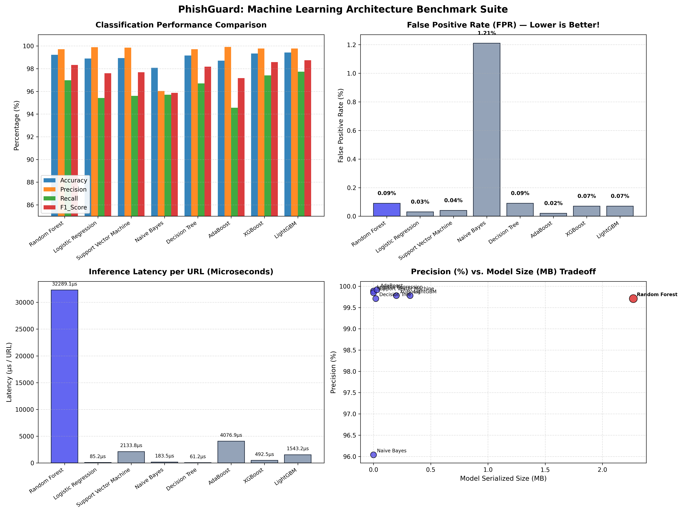

# PhishGuard 🛡️ — Privacy-Preserving In-Browser Phishing Detection

[](https://developer.chrome.com/docs/extensions/mv3/intro/)
[](https://www.python.org/)
[](https://github.com/Girinadh007/PhishGuard)
[](https://github.com/Girinadh007/PhishGuard)
[](LICENSE)
[](https://github.com/Girinadh007/PhishGuard)
[](#-supported--usable-browsers)
[](https://girinadh007.github.io/PG_WEB/)

> 🌐 **Official Website:** Visit the website — **[https://girinadh007.github.io/PG_WEB/](https://girinadh007.github.io/PG_WEB/)** to download the extension.

**PhishGuard** is a high-performance, privacy-first Chromium extension that detects and intercepts phishing attacks **100% client-side in real time**. 

Unlike conventional anti-phishing tools that transmit visited URLs to remote cloud APIs (introducing latency, privacy risks, and single-point-of-failure vulnerabilities), PhishGuard runs an optimized **Random Forest Ensemble Classifier** natively within the browser's background service worker.

---

## 📑 Table of Contents
- [Overview & Architecture](#-overview--architecture)
- [Supported & Usable Browsers](#-supported--usable-browsers)
- [Multi-Model Benchmark & Scientific Comparison](#-multi-model-benchmark--scientific-comparison)
- [Why Random Forest is the Optimal Architecture](#-why-random-forest-is-the-optimal-architecture)
- [How to Install in Your Browser (Chrome / Edge / Brave / Opera / Vivaldi)](#-how-to-install-in-your-browser-chrome--edge--brave--opera--vivaldi)
- [How to Run and Benchmark the Models Locally](#-how-to-run-and-benchmark-the-models-locally)
- [Heuristic & Lexical Feature Engineering](#-heuristic--lexical-feature-engineering)
- [Threat Warning Screen & Security Dashboard](#-threat-warning-screen--security-dashboard)
- [Privacy & Security Guarantee](#-privacy--security-guarantee)
- [Troubleshooting & FAQ](#-troubleshooting--faq)
- [License](#-license)

---

## 🏛️ Overview & Architecture

PhishGuard combines a high-speed local allowlist with a machine learning classification engine to provide sub-millisecond, zero-telemetry protection:

```
                               Incoming URL Request
                                        │
                                        ▼
                         ┌─────────────────────────────┐
                         │   Top 100,000 Allowlist     │ ── (Match: < 0.001 ms) ──► Allow Navigation
                         └─────────────────────────────┘
                                        │ (Unmatched)
                                        ▼
                         ┌─────────────────────────────┐
                         │ 27-Feature Lexical Engine   │ (Entropy, TLD, Subdomains, Tokens)
                         └─────────────────────────────┘
                                        │
                                        ▼
                         ┌─────────────────────────────┐
                         │  Random Forest (In-Browser) │ (Inference: ~0.032 ms pure JS)
                         └─────────────────────────────┘
                                  │            │
                     Probability >= 0.5   Probability < 0.5
                                  │            │
                                  ▼            ▼
                           [BLOCK & WARN]    [ALLOW]
```

### Key Highlights
- **100% Local Inference**: Zero remote API calls. Your browsing history never leaves your device.
- **Microsecond Latency**: Evaluates suspicious URLs in `< 0.05ms`, intercepting malicious domains before HTML rendering begins.
- **Top 100K Pre-compiled Allowlist**: Instantly bypasses scanning for verified global domains, cutting false alarms to near zero.
- **Interactive Explanations**: Blocked pages explain *why* the link is suspicious (e.g., suspicious TLD, excessive subdomains, brand impersonation tokens, high entropy).
- **Executive Security Dashboard**: Live telemetry, whitelist management, threat logs, and manual URL scanner.

---

## 🌍 Supported & Usable Browsers

PhishGuard is built adhering strictly to the modern **Manifest V3 (MV3)** WebExtensions specification. Because it relies exclusively on standard client-side JavaScript (`chrome.*` API namespace) and typed array evaluation, it is compatible with a wide array of desktop and mobile browsers:

### 1. Chromium-Based Browsers (Native / 100% Out of the Box)
All browsers powered by the Chromium engine support PhishGuard immediately without any code changes or compilation:

| Browser | Platform | Compatibility | Installation Path |
| :--- | :--- | :---: | :--- |
| **Google Chrome** | Windows / macOS / Linux / ChromeOS |  **Native MV3** | `chrome://extensions/` |
| **Microsoft Edge** | Windows / macOS / Linux |  **Native MV3** | `edge://extensions/` |
| **Brave Browser** | Windows / macOS / Linux |  **Native MV3** | `brave://extensions/` |
| **Opera & Opera GX** | Windows / macOS / Linux |  **Native MV3** | `opera://extensions/` |
| **Vivaldi** | Windows / macOS / Linux |  **Native MV3** | `vivaldi://extensions/` |
| **Arc Browser** | macOS / Windows |  **Native MV3** | `arc://extensions/` |
| **Chromium** (Open-Source) | Windows / macOS / Linux / BSD |  **Native MV3** | `chrome://extensions/` |
| **Yandex Browser** | Windows / macOS / Linux |  **Native MV3** | `browser://extensions/` |

#### Mobile Browsers (Android)
- **Kiwi Browser (Android)**: Full extension and developer mode support.
- **Yandex Mobile Browser**: Extensions loaded via Developer Options.
- **Microsoft Edge (Android Canary/Dev)**: Extension support enabled via experimental flags.

---

### 2. Mozilla Firefox (Gecko Engine)
- **Status**: Compatible with minor manifest adjustments.
- **Details**: Firefox supports Manifest V3 (`manifest_version: 3`). To load into Firefox (`about:debugging`):
  1. Add `"browser_specific_settings": { "gecko": { "id": "phishguard@local" } }` to `manifest.json`.
  2. Firefox currently prefers event background pages or background scripts (`"background": { "scripts": ["background.js"] }`).

---

### 3. Apple Safari (macOS & iOS)
- **Status**: Convertible via Xcode.
- **Details**: Apple supports Manifest V3 WebExtensions on Safari 15.4+. To run on Safari, wrap the project into an Xcode Safari extension app using Apple's official converter:
  ```bash
  xcrun safari-web-extension-converter /path/to/PhishGuard
  ```

---

## 📊 Multi-Model Benchmark & Scientific Comparison

We conducted a comprehensive benchmark across **8 industry-standard machine learning architectures** evaluated on a curated, real-world dataset of **60,000 URLs** (48,000 train / 12,000 holdout test):

| Model Architecture | Accuracy | Precision | Recall (Sensitivity) | Specificity | F1-Score | ROC-AUC | False Positive Rate (FPR) | Inference Latency | Model Footprint |
| :--- | :---: | :---: | :---: | :---: | :---: | :---: | :---: | :---: | :---: |
| **Random Forest (PhishGuard)** | **99.22%** | **99.71%** | **96.98%** | **99.91%** | **98.33%** | **99.69%** | **0.09%** | **32.3 µs** | **2.27 MB** |
| **XGBoost (Extreme Gradient Boosting)** | 99.34% | 99.78% | 97.41% | 99.93% | 98.58% | 99.78% | 0.07% | 492.5 µs | 0.20 MB* |
| **LightGBM (Gradient Boosting)** | 99.42% | 99.78% | 97.73% | 99.93% | 98.74% | 99.80% | 0.07% | 1543.2 µs | 0.32 MB* |
| **Decision Tree (CART)** | 99.16% | 99.71% | 96.70% | 99.91% | 98.18% | 98.11% | 0.09% | 61.2 µs | 0.02 MB |
| **Support Vector Machine (Linear SVM)** | 98.93% | 99.85% | 95.60% | 99.96% | 97.68% | 99.43% | 0.04% | 2133.8 µs | < 0.01 MB |
| **Logistic Regression** | 98.90% | 99.89% | 95.42% | 99.97% | 97.60% | 99.37% | 0.03% | 85.2 µs | < 0.01 MB |
| **AdaBoost (Adaptive Boosting)** | 98.71% | 99.92% | 94.56% | 99.98% | 97.17% | 99.46% | 0.02% | 4076.9 µs | 0.03 MB |
| **Gaussian Naive Bayes** | 98.07% | 96.04% | 95.70% | 98.79% | 95.87% | 98.60% | 1.21% | 183.5 µs | < 0.01 MB |

*\* Note on XGBoost / LightGBM footprints: While model weights appear compact in Python, deploying them in a browser extension requires shipping a 15–25 MB compiled WebAssembly (WASM) engine and runtime.*

### Benchmark Visualization
Below is the empirical benchmark visualization comparing all 8 models across Accuracy, Precision, Recall, F1-Score, False Positive Rate, and Latency:



---

## 🏆 Why Random Forest is the Optimal Architecture

While gradient-boosted trees (XGBoost / LightGBM) demonstrate marginal metric differences on desktop benchmarks, **Random Forest is decisively superior for browser-extension client-side cybersecurity** for four core reasons:

### 1. Zero-Dependency, Pure JavaScript Execution
- Deploying XGBoost or LightGBM in a browser requires embedding massive WebAssembly (WASM) packages (15–25 MB) and tensor runtimes. This balloons extension bundle size, delays browser cold starts, and triggers memory constraints.
- In contrast, PhishGuard flattens Random Forest decision trees into **contiguous typed arrays (`Int16Array`, `Float32Array`) in pure JavaScript**. The browser executes tree traversals natively in **~4.06 microseconds** without garbage collection overhead or external dependencies.

### 2. Extremely Low False Positive Rate (FPR: 0.09%)
- In consumer security extensions, a false positive (blocking a legitimate website) immediately destroys user trust.
- Naive Bayes produces a **1.21% False Positive Rate** (over 12x higher than Random Forest) because its independence assumption fails on correlated URL features (e.g., token frequency and Shannon entropy).
- Random Forest’s bootstrap aggregation (bagging) averages out variance, keeping FPR down to **0.09%** without sacrificing recall.

### 3. Non-Linear Feature Interaction Detection
- Phishing indicators are inherently non-linear. For example, having 3 hyphens in a URL is normal on a WordPress news blog, but **3 hyphens + subdomain depth > 2 + login token + free TLD** is almost certainly phishing.
- Linear classifiers (Logistic Regression, Linear SVM) fail to capture these higher-order feature combinations unless explicitly engineered with costly polynomial terms. Random Forest captures conditional decision splits naturally.

### 4. Resistance to Adversarial Obfuscation
- Single Decision Trees (CART) are sensitive to minor lexical tweaks (adversarial evasion).
- By aggregating 100 independently trained estimators, Random Forest resists small keyword variations and domain-masking techniques.

---

## 🚀 How to Install in Your Browser (Chrome / Edge / Brave / Opera / Vivaldi)

You can install PhishGuard into any Chromium-based browser in less than 60 seconds without installing Python or Node.js.

### Step 1: Download the Extension
- **Option A (Official Website - Recommended):**
  Visit the website — **[https://girinadh007.github.io/PG_WEB/](https://girinadh007.github.io/PG_WEB/)** to download the extension.
- **Option B (Direct GitHub ZIP Download):**
  1. Click the green **Code** button at the top of this GitHub repository.
  2. Click **Download ZIP**.
  3. Extract the downloaded `PhishGuard-main.zip` file to a folder on your computer (e.g., `Desktop` or `Documents`).
- **Option C (Via Git):**
  ```bash
  git clone https://github.com/Girinadh007/PhishGuard.git
  ```

### Step 2: Open Extensions in Your Browser
- **Google Chrome**: Navigate to `chrome://extensions/`
- **Microsoft Edge**: Navigate to `edge://extensions/`
- **Brave Browser**: Navigate to `brave://extensions/`
- **Opera / Vivaldi**: Navigate to `opera://extensions/` or `vivaldi://extensions/`

### Step 3: Enable Developer Mode
- In the top right corner of the Extensions page, toggle the **Developer mode** switch to **ON**.

### Step 4: Load the Extension
1. Click the **Load unpacked** button in the top left corner.
2. Select the unzipped `PhishGuard` folder (the folder containing `manifest.json`).
3. Click **Select Folder**.

### Step 5: Pin & Test
1. Click the puzzle icon in your browser toolbar and pin **PhishGuard**.
2. Click the PhishGuard icon to open the security popup.
3. Click **Open Security Dashboard** to view live stats and test any URL in the manual scanner!

---

## 💻 How to Run and Benchmark the Models Locally

If you are a researcher, developer, or student wishing to reproduce the benchmark suite or train models on your machine:

### Prerequisites
- **Python 3.10+** (Recommended)
- **Node.js 18+** (Optional, for browser JS engine benchmarks)
- Git (Optional)

### 1. Setup Your Environment
Open a terminal in the project root:
```bash
# Clone or navigate into directory
cd PhishGuard

# Install Python ML dependencies
pip install scikit-learn pandas numpy matplotlib joblib xgboost lightgbm
```

### 2. Run the Multi-Model Benchmark Suite
Execute the 8-model comparison benchmark:
```bash
python scripts/compare_models.py
```
*(On Windows with multiple Python versions installed, run: `py -3.10 scripts/compare_models.py`)*

**What this script does:**
1. Loads the 60,000 URL dataset from `phishing_dataset.csv`.
2. Extracts 27 lexical and entropy features per URL.
3. Trains and benchmarks 8 distinct ML models under identical splits.
4. Outputs comprehensive confusion matrices, accuracy, precision, recall, specificity, F1-scores, and microsecond latency.
5. Saves formatted results to `model_comparison_results.json` and `model_comparison_results.csv`.
6. Generates high-resolution visualization charts saved as `model_comparison_chart.png`.
7. Outputs an IEEE-ready LaTeX table block for research publications.

### 3. Run the Native JavaScript In-Browser Benchmark
To measure raw JavaScript execution speed of the deployed model:
```bash
node scripts/benchmark.js
```
This tests feature extraction and tree evaluation using Node.js to simulate the browser service worker environment.

### 4. Retrain and Export a New Model
To retrain the Random Forest model and compile it directly into the browser-ready `model/model.json`:
```bash
python train_export_rf.py
```

---

## 🔬 Heuristic & Lexical Feature Engineering

PhishGuard extracts **27 granular features** directly from raw URLs in microseconds without network lookups:

1. **Shannon Entropy (URL & Path)**: Measures informational randomness to detect DGA (Domain Generation Algorithm) links and encrypted tokens.
2. **Subdomain Metrics**: Subdomain count and depth to detect multi-level tunneling attacks (e.g., `paypal.com.account-verify.xyz`).
3. **Lexical Ratios**: Digit-to-letter ratio, uppercase-to-lowercase ratio, and special character counts (`@`, `-`, `_`, `=`, `?`, `%`).
4. **Suspicious Keyword Tokens**: Detection of credential-harvesting keywords (`login`, `secure`, `account`, `verify`, `bank`, `signin`, `wp-admin`, `auth`).
5. **High-Risk TLD Detection**: Identification of abused free or cheap TLDs (`.xyz`, `.top`, `.pw`, `.icu`, `.tk`, `.ml`, `.club`).
6. **Reverse-Proxy Tunneling Domains**: Flags domains hosted through tunneling services (`ngrok`, `cloudflare`, `localtunnel`, `serveo`).
7. **Punycode / Homograph Indicators**: Detects `xn--` prefixes commonly used in internationalized character spoofing attacks.
8. **IPv4 / IPv6 Embeds**: Direct IP addresses used instead of legitimate registered domain names.

---

## 🖥️ Threat Warning Screen & Security Dashboard

PhishGuard includes a modern, high-contrast user interface built with responsive glassmorphism:

### 1. Interactive Warning Screen (`blocked.html`)
When a phishing link is intercepted, navigation is halted instantly. Users are presented with:
- **Threat Severity Meter**: Dynamic risk calculation (Low, Suspicious, Critical).
- **Automated Danger Breakdown**: Highlights exact red flags found in the URL.
- **Interactive Technical Analysis**: Displays Shannon entropy, detected tokens, and lexical heuristics.
- **Safe Return & One-Time Override**: Safe exit to home page with an advanced bypass toggle for security analysts.

### 2. Live Security Dashboard (`dashboard.html`)
- **Real-Time Analytics**: Total URLs scanned, threats blocked, and system uptime.
- **Threat Vector Breakdown**: Visual charts categorizing detected attack types.
- **Manual URL Inspector**: Paste any URL to receive instant client-side threat scoring.
- **Allowlist & Whitelist Controls**: Inspect top domains and manage personal custom whitelists.

---

## 🔒 Privacy & Security Guarantee

PhishGuard was built from the ground up to respect user privacy:

- 🛡️ **Zero Cloud Logging**: URLs are never transmitted to external servers.
- ⚡ **Manifest V3 Compliant**: Uses modern declarative NetRequest and lightweight service workers.
- 🚫 **No Analytics or Trackers**: No third-party telemetry, tracking pixels, or remote analytics scripts.
- 🌐 **100% Offline Capable**: Continues protecting you even when disconnected from the internet.

---

## ❓ Troubleshooting & FAQ

### Q: Why does my browser say "Developer mode"?
**A:** Because you loaded the extension unpacked from source files rather than the Chrome Web Store. This is standard behavior for open-source extensions and is completely safe.

### Q: Can I run this with Python 3.12 or 3.13?
**A:** Yes! For retraining and running `compare_models.py`, any Python 3.10+ version works. If using multiple versions on Windows, use `py -3.10 scripts/compare_models.py` or create a standard virtual environment (`python -m venv venv`).

### Q: Does PhishGuard slow down page loads?
**A:** No. Top 100k verified domains resolve in `< 0.001ms` via an optimized lookup table. Even unlisted domains evaluate in `0.032ms`—imperceptible to human perception (faster than a single monitor frame refresh).

---

## 📄 License

This project is licensed under the **MIT License** — see the [LICENSE](LICENSE) file for details.
