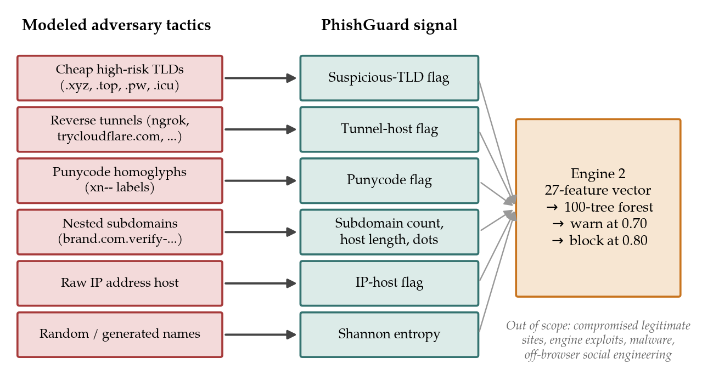
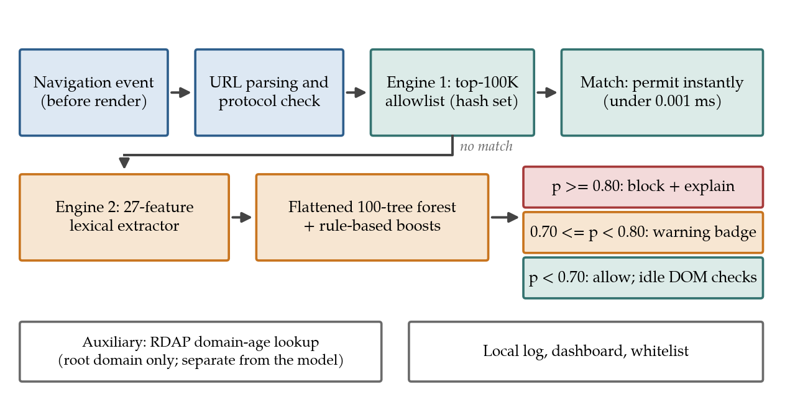
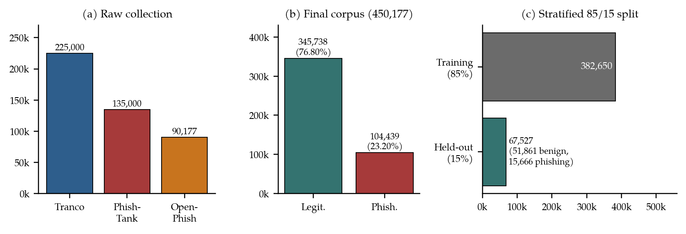
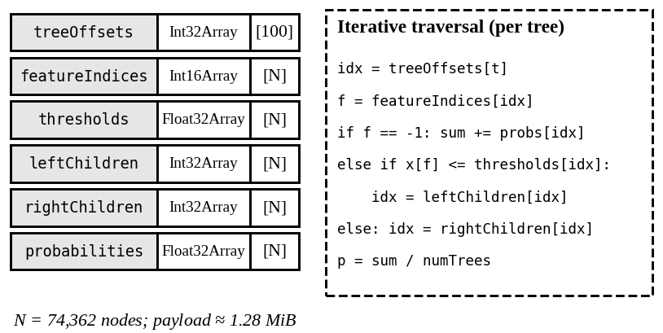
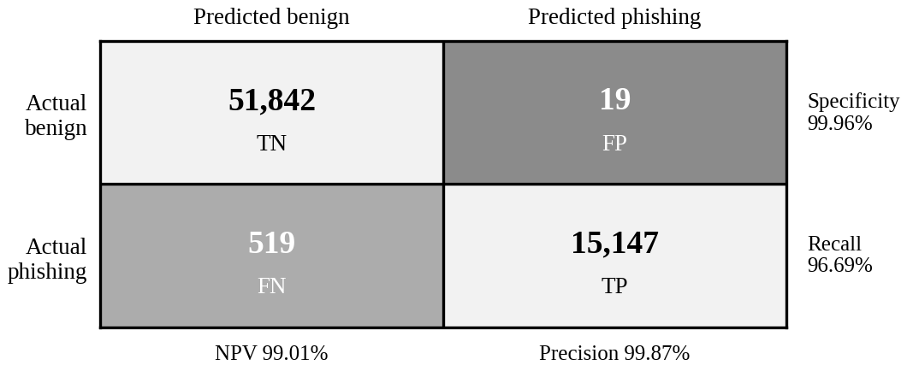
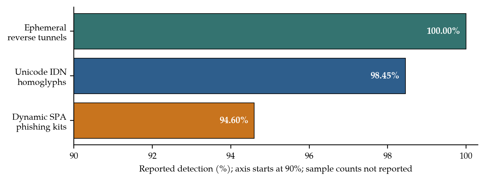
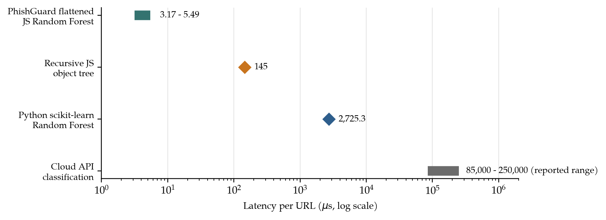
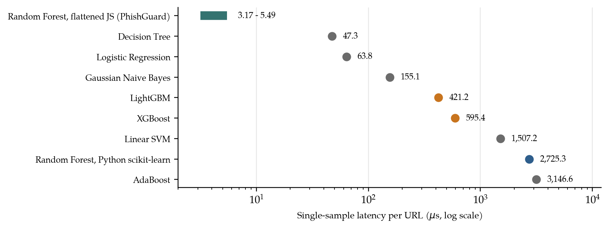
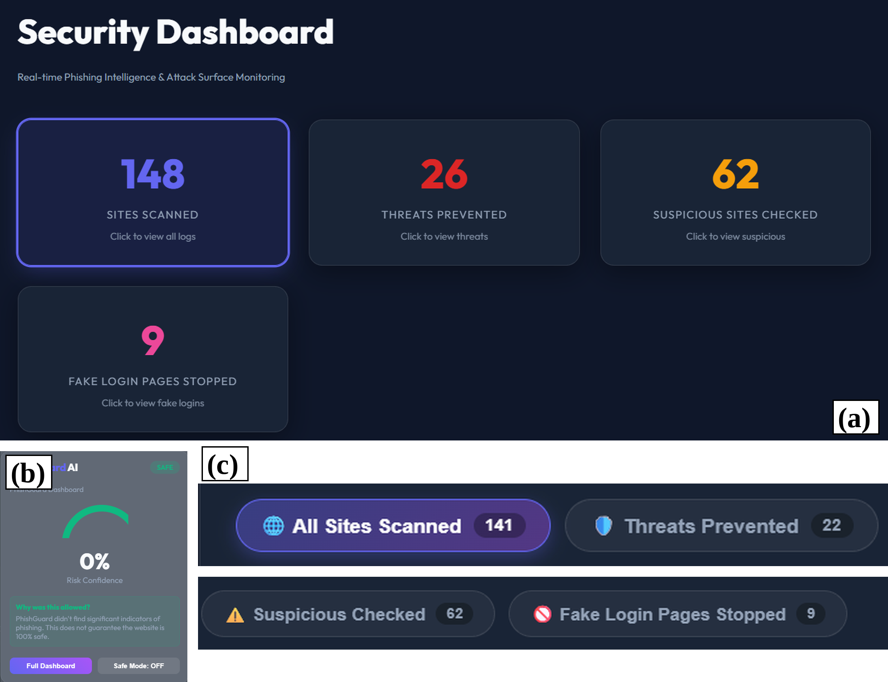

# PhishGuard: An Intelligent Browser Extension for Phishing Detection

**Dr. R. Rajasubramanian** $^{1,*}$, **P. Venkata Girinadh** $^{2}$, **Sk. Imamsa** $^{2}$, **K. Bhargav Teja** $^{2}$  

$^{1}$ *Department of Computer Science and Engineering (Head of the Department), Kalasalingam Academy of Research and Education, Krishnankoil – 626126, Virudhunagar, Tamil Nadu, India.*  
$^{2}$ *Department of Computer Science and Engineering (Students), Kalasalingam Academy of Research and Education, Krishnankoil – 626126, Virudhunagar, Tamil Nadu, India.*  
$^{*}$ *Correspondence:* `rajasubramanian.r1@gmail.com`  
**Open-Source Repository:** [https://github.com/Girinadh007/PhishGuard](https://github.com/Girinadh007/PhishGuard)  

---

### Abstract
Phishing infrastructure rotates faster than reputation feeds can follow, and cloud classifiers expose users’ browsing data. This paper presents **PhishGuard**, a Chromium Manifest V3 extension that classifies URLs on the client without sending them to a classification service. A 100-tree Random Forest over 27 lexical and entropy features is compiled into contiguous typed arrays and executed in the extension service worker behind a top-100K allowlist, with optional local page-structure heuristics. The corpus contains 450,177 URLs from Tranco, PhishTank, and OpenPhish. On a stratified held-out set of 67,527 URLs, PhishGuard achieved 99.20% accuracy, 99.87% precision, 96.69% recall, 98.26% F1-score, 99.59% ROC-AUC, and a 0.0366% false-positive rate. Forest inference took 3.17–5.49 microseconds per URL, against 145 microseconds for a recursive JavaScript object-tree baseline, with no heap allocation in timed runs. Eight classifiers were compared, and challenge sets gave 100.00% (reverse tunnels), 98.45% (IDN homoglyphs), and 94.60% (SPA kits) detection. These results describe the tested implementation and runtime environment.

**Keywords:** phishing detection, browser extension, Manifest V3, Random Forest, typed arrays, URL analysis, client-side inference, privacy.

---

## 1. Introduction

### 1.1 Context
Phishing remains one of the most persistent ways in which credentials and money are stolen online, because it targets the user’s decision at the moment of navigation rather than a flaw in software. Attackers register cheap domains, abuse hosting and reverse-tunnel services, and imitate legitimate brands with look-alike names, so the infrastructure behind a campaign can change faster than defenders can catalogue it [1], [2]. A blacklist or reputation feed can warn about a URL only after it has been observed, reported, verified, and published, which leaves a window between deployment and listing in which victims are exposed.

Machine-learning classifiers that inspect the URL string, and visual or page-content systems that inspect the rendered page, provide complementary signals that do not depend on a URL having been seen before [3]–[6]. Their deployment, however, is rarely neutral for the user. A cloud-hosted classifier receives every URL that the user visits, which exposes browsing data to a third party, adds a network round trip of roughly 50–300 ms to each decision, and stops working offline. In-browser alternatives based on WebAssembly avoid the round trip but typically ship runtimes of 15–25 MB and pay a cold-start cost. The practical question is therefore not only how accurate a detector is, but where it runs and what it must reveal in order to run.

The browser is a natural place for a last-line decision because it sees the navigation event before the page renders. The Manifest V3 extension platform of Chromium, built around event-driven service workers, makes it possible to intercept navigation while keeping the model and its data on the device [7]. This paper examines whether a compact tree ensemble, stored in a layout that suits the JavaScript runtime, can serve as that on-device decision layer without sacrificing detection quality.

### 1.2 Existing Literature and Its Limitations
Research on phishing detection spans several families of methods. Sheng et al. assessed weaknesses of phishing blacklists, and Oest et al. later measured how quickly such lists cover new attacks [1], [2]. Ma et al. showed that lexical and host-based characteristics of URLs are sufficient to learn a useful classifier [3], and subsequent surveys and studies reviewed the learning methods and features used for malicious-URL and phishing-URL detection [4], [8], [9]. Deep models that learn character-level and word-level URL representations have also been proposed [10]. Homograph attacks, in which visually similar characters imitate a trusted name, have been studied both as a measurement problem and as a standardization problem [11]–[13]. Visual and content-driven systems such as Phishpedia, PhishIntention, CANTINA, and large-scale page classification use evidence beyond the URL string [5], [6], [14]–[16].

These studies establish that phishing can be detected from several kinds of evidence, but they also leave practical limitations. Reputation lists lag behind newly created URLs. Remote machine-learning services expose browsing data and add latency. Visual and page-content detectors need the page to be rendered and cost on the order of 100–1200 ms. Client-side ensembles compiled to WebAssembly achieve high predictive accuracy but carry large runtimes, and gradient-boosted trees, although strong [17], [18], need such a runtime when they are executed in the browser [19]. In addition, empirical work on browser warnings shows that a correct detection is useful only when the warning is understood and heeded [20], [21]. Few studies treat the packaging of a detector, meaning its model layout, runtime footprint, and privacy boundary, as a design problem on a par with its accuracy.

### 1.3 Objective of the Research
The overall aim of this work is to design, implement, and evaluate a local-first phishing detector for Chromium browsers that keeps classification on the client, responds within microseconds, and gives the user an explanation when it blocks a page. This aim is pursued through four specific objectives:
1. To design a Manifest V3 pipeline that combines a popular-domain allowlist, a lexical Random Forest, and optional in-page structural heuristics;
2. To assemble a labelled corpus and to train and evaluate the forest on 27 lexical and entropy features using a stratified held-out set;
3. To compile the trained forest into flat typed arrays and to measure its latency and memory behaviour against a recursive object-tree baseline and seven alternative classifiers; and
4. To examine behaviour on challenge sets for reverse tunnels, homoglyph domains, and single-page-application kits, and to state clearly the limits of the evidence.

### 1.4 Present Research
The present research develops **PhishGuard**, a browser extension organized as a two-engine pipeline. 

* **Engine 1** is an allowlist of the 100,000 most popular domains, compiled offline from a popularity ranking into an in-memory hash set so that a match permits navigation in under 0.001 ms. 
* **Engine 2** handles every other URL: a single-pass extractor computes 27 lexical features, a 100-tree Random Forest returns a risk score $p \in [0, 1]$, a score of at least 0.70 raises a warning, and a score of at least 0.80 halts navigation and opens an explanatory block page. Lower scores are permitted, optionally followed by idle-time checks of the page structure, such as a password field on an untrusted server or a form that posts to an unrelated external endpoint.

The forest is stored as six parallel typed arrays holding 74,362 nodes in a payload of about 1.28 MiB, and traversal is iterative rather than recursive. The model was trained and scored on a corpus of 450,177 URLs drawn from Tranco, PhishTank, and OpenPhish. A security dashboard keeps local scan logs, threat counts, a whitelist, and a manual URL inspector. The design deliberately adds a local signal to browser warnings and reputation services rather than replacing them.

### 1.5 Contributions
The core contributions of this work are summarized as follows:
1. **Architecture contribution:** A local-first design for Chromium Manifest V3 in which feature extraction, inference, and the warning or blocking decision all run inside the extension service worker, with no URL sent to a classification service.
2. **Model-representation contribution:** A Random Forest flattened into contiguous typed arrays and traversed iteratively, avoiding object allocation, pointer chasing, and recursion call-frames during inference.
3. **Empirical contribution:** A systematic comparison of eight classifiers on 450,177 URLs, reporting accuracy, precision, recall, F1-score, false-positive rate, and in-browser latency on identical splits.
4. **Performance contribution:** Microsecond inference ($3.17\text{--}5.49\ \mu\text{s}$ per URL against $145\ \mu\text{s}$ for a recursive object-tree baseline), making pre-render navigation interception practical.
5. **Practical contribution:** An explanatory block page, a local telemetry dashboard, and an explicit statement of the validity limits and reproducibility requirements of the evaluation. The primary highlight of this work is the combination of an allowlist, lexical learning, and a compact runtime layout in one deployable system rather than the isolated novelty of any single component.

### 1.6 Structure of the Paper
The rest of the paper is organized as follows: Section 2 reviews previous work on blacklists, lexical and machine-learning URL classification, homograph attacks, visual and content-driven detection, client-side inference, and warning design, identifying the research gap. Section 3 states the research questions and hypotheses, presenting the theoretical and conceptual framework alongside the threat model. Section 4 describes the materials and methods, including dataset acquisition, feature extraction, model layout, decision logic, baseline models, and evaluation protocol. Section 5 presents and discusses experimental results across classification quality, challenge sets, runtime microbenchmarks, multi-model comparisons, browser deployment, robustness, and limitations. Section 6 concludes the paper.

---

## 2. Related Work and Research Gap

Related work spans six interconnected areas: reputation-based protection, lexical and machine-learning URL classification, homograph and internationalized-domain attacks, visual and content-driven detection, client-side browser inference, and security warning design.

### 2.1 Reputation-Based Protection
Blacklists are the oldest and most widely deployed defence against phishing because a lookup is fast and a listed indicator is known to be malicious. Sheng et al. conducted an empirical analysis of phishing blacklists and found that coverage of new campaigns was incomplete and delayed [1]. Oest et al. extended this view with *PhishTime*, a continuous longitudinal measurement of how effective anti-phishing blacklists are over time [2]. Whittaker et al. described an automatic page classifier operating at large scale that feeds such lists [15]. These works show that reputation data are indispensable but inherently reactive, and that short-lived URLs may be abandoned before they are listed. PhishGuard therefore treats reputation as one layer and adds a local, content-independent signal for URLs that no list has yet seen.

### 2.2 Lexical and Machine-Learning URL Classification
Ma et al. demonstrated that lexical features of the URL, together with host-based features, can be learned to separate malicious from benign sites without fetching the page [3]. Sahingoz et al. studied machine-learning-based phishing detection from URLs and compared several classifiers on engineered features [8], and Verma and Dyer examined the character of phishing URLs and the robustness of statistical learning classifiers built on it [9]. The survey by Sahoo et al. organizes malicious-URL detection by feature type and learning method and discusses practical challenges such as concept drift and scale [4]. Deep alternatives such as URLNet learn character-level and word-level URL representations end to end [10]. Among traditional learners, Random Forest [22] is attractive for deployment because it needs no feature scaling, handles mixed numeric and binary features, and averages many decorrelated trees to reduce variance. PhishGuard follows this line, restricts itself to inexpensive lexical and entropy features that can be computed in a single pass, and concentrates on how the resulting forest is stored and executed.

### 2.3 Homograph and Internationalized-Domain Attacks
Homograph attacks substitute visually similar characters, for example Cyrillic or Greek letters in a Latin brand name, to create a domain that looks identical to the legitimate one. Holgers et al. measured the prevalence and potential of such attacks [11], the Unicode Consortium published security mechanisms that define confusable-character handling [12], and the IDNA protocol specification defines how internationalized labels are encoded with the `xn--` prefix [13]. A complete defence compares candidate domains against confusable skeletons of protected brands, which requires brand data and Unicode tables. PhishGuard takes a lighter approach in which the presence of Punycode is one of four heuristic features, and the evaluation reports how well the combined model detects homoglyph domains in a separate challenge set.

### 2.4 Visual and Content-Driven Detection
Visual and content-driven systems use evidence from the rendered page. CANTINA scores pages with content-based term-frequency analysis [14], and Marchal et al. exploit the relationship between terms in a page and its URL to detect phishing sites and their targets [16]. Phishpedia identifies the brand logo with a hybrid deep-learning pipeline and compares the page domain with the brand’s domain [5], and PhishIntention extends this to webpage appearance and dynamics in order to infer the credential-taking intention of the page [6]. These systems can detect pages whose URLs look unremarkable, but they need the page to be fetched and rendered and incur runtimes of about 100–1200 ms. PhishGuard does not compete with them in the breadth of evidence. It targets the earlier moment, the navigation event, and adds only minimal in-page structural checks after the page has loaded.

### 2.5 Client-Side Inference in Browsers
Chromium extensions built on Manifest V3 run background logic in service workers that are started by events and may be terminated when idle, which constrains the memory and start-up cost of any bundled model [7]. WebAssembly allows trained models to run in the browser at near-native speed in many cases, although the measurement study of Jangda et al. shows that the gap to native code depends on the workload and the engine [19]. Gradient-boosted tree libraries such as XGBoost and LightGBM provide strong accuracy on tabular features [17], [18], and the classical learners used as baselines in this paper, namely Decision Tree, Logistic Regression, Linear SVM, AdaBoost, and Gaussian Naive Bayes, are available in widely used toolkits such as scikit-learn [23]. PhishGuard avoids a bundled runtime by exporting the trained forest as data and executing it with a short loop in plain JavaScript.

### 2.6 Warning Design and User Behaviour
A detector can protect a user only if its warning is noticed and followed. Egelman et al. compared the effectiveness of browser phishing warnings and found that the design of the warning strongly influences whether users comply [20], and Akhawe and Felt studied browser security warnings in a large-scale field study, showing that users’ responses vary widely with how the warning is presented [21]. These findings motivate two design choices in PhishGuard: the block page states which heuristics triggered the decision and offers a safe exit, and the false-positive rate is treated as a first-class quality measure, since excessive warnings can train users to ignore real alerts.

### 2.7 Research Gap
Based on the analysed literature, three directions can be distinguished:
* Reputation-based studies address known threats and their coverage over time.
* Learning-based studies, from lexical classifiers to visual deep networks, address detection quality, often with server-side or desktop evaluation.
* Deployment-oriented studies address the browser as a runtime but rarely combine a detection model with an explicit privacy boundary, a measured latency budget, and a user-facing explanation.

As summarized in Table I, few works combine an allowlist, lexical learning, a runtime-friendly model layout, and a local privacy boundary in one extension, and report both detection metrics and in-browser microbenchmarks. Therefore, the current study aims at combining existing, well-understood techniques into a deployable local-first design. This work does not claim a new learning algorithm or a detector that dominates all others. The attention is on the system design and on a transparent statement of what the evidence does and does not show.

#### Table I. Research Gap Comparison of Related Approaches and PhishGuard

| Approach | Strength | Limitation addressed by PhishGuard |
| :--- | :--- | :--- |
| **Reputation lists** [1], [2] | Fast for known indicators | New or short-lived URLs may not yet be listed |
| **Remote ML classifiers** [3], [4], [8] | High model capacity | Exposes browsing data; 50–300 ms network latency |
| **Visual / DOM deep learning** [5], [6] | Detects brand and page-appearance cues | Needs full page rendering; 100–1200 ms overhead |
| **Client-side WASM ensembles** [17]–[19] | High predictive accuracy | 15–25 MB runtime bundle; slow worker cold-start |
| **PhishGuard (this study)** | Local lexical inference with optional DOM signals | Needs broader reproducibility and usability evaluation |

---

## 3. Theoretical and Conceptual Framework

### 3.1 Purpose, Research Questions and Hypotheses
The purpose of this study is to determine whether a phishing detector that runs entirely inside the browser can reach high detection quality at microsecond cost, and to document the conditions under which that statement holds. The study is guided by five research questions, each of which is paired with an operational hypothesis.

#### Table II. Research Questions, Hypotheses and Evidence Used

| ID | Research question | Hypothesis (operational form) | Evidence |
| :--- | :--- | :--- | :--- |
| **RQ1** | How accurately does a 27-feature lexical Random Forest separate phishing from benign URLs, and at what false-alarm cost? | **H1:** Accuracy is $\ge 99\%$ and the false-positive rate is $< 0.1\%$ on the held-out set at the 0.50 benchmark threshold. | Table IV, Fig. 5 |
| **RQ2** | Does flattening the forest reduce per-URL latency relative to a recursive object tree? | **H2:** The flat forest is at least $10\times$ faster in the same benchmark and allocates no heap memory in timed runs. | Table VI, Fig. 7 |
| **RQ3** | How does the forest compare with seven alternative classifiers when accuracy, false alarms, and deployability are weighed together? | **H3:** The forest stays within 0.5 points of the most accurate model, and its flattened implementation runs at microsecond cost without an external runtime. | Table VII, Fig. 8 |
| **RQ4** | Is detection retained on structurally distinct evasion patterns? | **H4:** Detection exceeds 90% in each challenge category. | Table V, Fig. 6 |
| **RQ5** | Can classification run without a network request? | **H5:** In the observed setup, feature extraction and forest inference issue no network request. | Section 5.7 |

### 3.2 Theoretical Foundations

#### Ensemble Learning
A Random Forest builds many decision trees on bootstrap samples of the training data and, at each split, considers only a random subset of features, which decorrelates the trees [22]. Each tree partitions the feature space with axis-aligned thresholds chosen to reduce an impurity criterion such as the Gini impurity of a node:

$$G(S) = 1 - \sum_{k} p_k^2 \tag{1}$$

where $p_k$ is the fraction of samples of class $k$ in node $S$. Averaging many such trees lowers variance without significantly increasing bias. The mean of the leaf probabilities of $T$ trees provides an overall score:

$$p(u) = \frac{1}{T} \sum_{t=1}^{T} p_t(u) \tag{2}$$

where $p_t(u)$ is the leaf probability reached by URL $u$ in tree $t$. The score is a risk indicator useful for ranking and thresholding, rather than a calibrated probability of compromise.

#### Lexical and Information-Theoretic Evidence
The lexical hypothesis underlying URL classification is that deception and automation leave measurable traces in the string: unusual length, deep subdomain nesting, many delimiters, credential-lure tokens, and character statistics that differ from human-chosen names [3], [8], [9]. The Shannon entropy of a URL string $S$ with character probabilities $P(c_i)$ quantifies character unpredictability [24]:

$$H(S) = - \sum_{i=1}^{k} P(c_i) \log_2 P(c_i) \tag{3}$$

Benign URLs typically show entropy of about 3.2–4.1, whereas random tokens and algorithmically generated domains reach about 4.8–6.5. Entropy is therefore one feature among 27 and not a standalone decision rule.

#### Decision-Theoretic View
Blocking a navigation has asymmetric costs. A missed phishing page may lead to credential loss, whereas a false alarm interrupts a legitimate task and erodes trust in later warnings [20], [21]. A single threshold $\tau$ turns the ranking into a decision:

$$\hat{y}(u) = \begin{cases} 1\ (\text{block}) & \text{if } p(u) \ge \tau \\ 0\ (\text{allow}) & \text{otherwise} \end{cases} \quad (\tau = 0.50\text{ for the benchmark}) \tag{4}$$

Raising $\tau$ lowers false alarms and raises misses, and lowering it does the opposite. The benchmark metrics use the conventional $\tau = 0.50$ scikit-learn rule. The deployed extension uses two operational thresholds: $\tau_{\text{warn}} = 0.70$ (warning badge and Safe Mode) and $\tau_{\text{block}} = 0.80$ (halts navigation).

#### Data Layout and Execution Cost
A forest stored as linked objects requires pointer dereferences, recursion frames, and garbage-collected allocations. Contiguous typed arrays store the same information in densely packed, fixed-type memory so that traversal becomes an indexed loop. That this layout is faster is an empirical hypothesis about the runtime (H2), bounded to the engine and hardware in which it was observed.

### 3.3 Conceptual Framework
The conceptual framework consists of four primary stages: **Acquisition $\to$ Feature Extraction $\to$ Local Inference $\to$ Decision and Presentation** (see Fig. 2). 
1. *Acquisition* intercepts the navigation URL before the page renders and, optionally, inspects the loaded document at idle time.
2. *Feature Extraction* converts the URL into a 27-dimensional lexical vector.
3. *Local Inference* first consults the allowlist and, for unmatched URLs, evaluates the flattened forest.
4. *Decision and Presentation* compares the score with warning and blocking thresholds, displays warnings, explanatory blocks, or passes, and records the event in the local log.

### 3.4 Threat Model and Scope
PhishGuard addresses deceptive navigation links and pages that harvest credentials. The modeled adversary registers cheap high-risk domains (`.xyz`, `.top`, `.pw`, `.icu`), abuses reverse-tunnel services (`ngrok`, `trycloudflare.com`, `localtunnel.me`, `serveo.net`), spoofs brands with Punycode homoglyphs (`xn--`) [13], nests subdomains (e.g., `paypal.com.verify-account-security.online`), or embeds raw IP addresses. 

  
*Fig 1. Modeled adversary tactics and the corresponding PhishGuard signals.*

*Out of Scope:* Compromised legitimate sites with normal URLs, browser-engine zero-days, post-download binary malware, and off-browser social engineering.

### 3.5 Privacy Boundary
Feature extraction and forest inference run locally and issue no network request, ensuring the browsing URL is never sent to a classification service. As an auxiliary defence, the service worker queries public RDAP registration records through `rdap.org` to check the age of unfamiliar root domains outside the allowlist, disclosing the root domain but never the full URL path. Ordinary navigation, DNS resolution, and background OTA model-update checks can still generate network traffic.

---

## 4. Materials and Methods

  
*Fig 2. Local two-engine PhishGuard analysis pipeline.*

### 4.1 Experimental Setting
PhishGuard is implemented as a Chromium Manifest V3 extension whose service worker hosts the allowlist, feature extractor, and forest [7]. Benchmarks were executed on an Infinix ZEROBOOK 13 laptop (13th-Gen Intel Core i9, 32 GB RAM, 1 TB SSD, Windows 11) using Chrome. Each measurement used 1,000 warm-up cycles followed by 10,000 timed runs measured via the browser `Performance.now()` API. The model has 100 trees of maximum depth 14 and 74,362 nodes.

### 4.2 System Architecture and Component Configuration
* **Engine 1 (Allowlist):** In-memory hash set of the top 100,000 domains compiled offline from popularity rankings (`top-1m.csv`). A match permits navigation in $< 0.001\text{ ms}$.
* **Engine 2 (ML Classifier):** Extracts 27 lexical features, evaluates the flattened forest, applies heuristic risk boosts, and compares against operational thresholds:
  * $p \ge 0.80$: Immediate navigation cancellation; redirect to `blocked.html`.
  * $0.70 \le p < 0.80$: Navigation permitted with active warning badge and Safe Mode.
  * $p < 0.70$: Navigation allowed; background idle-time DOM heuristics activated.
* **Idle DOM Heuristics:** Injects non-blocking checks looking for password fields on untrusted origins, cross-domain form submission targets, and brand name mismatches.

### 4.3 Data Acquisition
The raw collection comprised 225,000 benign records from Tranco [25], 135,000 phishing records from PhishTank, and 90,177 phishing records from OpenPhish. After deduplication and label cleaning, the final corpus contains **450,177 URLs** (345,738 legitimate / 76.80% and 104,439 phishing / 23.20%). A stratified 85/15 split yielded 382,650 training URLs and a held-out set of 67,527 URLs (51,861 benign and 15,666 phishing). Separate challenge sets evaluate reverse tunnels, IDN homoglyphs, and SPA phishing kits.

  
*Fig 3. Raw collection, final class composition, and partition of the corpus.*

### 4.4 Data Preprocessing
URLs were parsed into standard RFC components (scheme, host, subdomain labels, path, query). The popularity ranking (`top-1m.csv`) was filtered to the top 100,000 root domains and serialized to `allowlist.json` without paths or labels, keeping it entirely disjoint from supervised training.

### 4.5 Feature Extraction
The 27-dimensional vector describes URL syntax, structure, and character distributions in a single pass without external network lookups.

#### Table III. Summary of URL Lexical Feature Groups (27 Features)

| Feature family | Dimension | Representative features | Detection purpose |
| :--- | :---: | :--- | :--- |
| **Structure** | 6 | `url_length`, `host_length`, `path_length`, `subdomain_count`, `count_slash`, `num_digits` | Unusually long, padded, or deeply nested URLs |
| **Delimiters** | 5 | `count_dots`, `count_hyphens`, `count_at`, `count_percent`, `has_https` | Delimiter manipulation, basic-auth abuse, hex escaping |
| **Heuristics** | 4 | `has_ip`, `suspicious_tld`, `is_tunnel`, `is_homograph` | IP hosts, abused TLDs, reverse tunnels, Punycode (`xn--`) |
| **Tokens** | 11 | `tok_login`, `tok_secure`, `tok_account`, `tok_update`, `tok_verify`, `tok_bank`, `tok_confirm`, `tok_signin`, `tok_wp-admin`, `tok_admin`, `tok_auth` | Credential and administrative lure tokens |
| **Entropy** | 1 | Shannon entropy $H(S)$ of full URL string | Obfuscation, randomness, and DGA domain generation |

### 4.6 Random Forest Model and Flattened Representation
Instead of tree-linked JavaScript objects, PhishGuard flattens the 100 trees into six contiguous parallel typed arrays:
* `treeOffsets` (`Int32Array[100]`): Node start indices for each tree (400 bytes).
* `featureIndices` (`Int16Array[74362]`): Feature index evaluated at node, or `-1` for leaf (148,724 bytes).
* `thresholds` (`Float32Array[74362]`): Decision boundary split thresholds (297,448 bytes).
* `leftChildren` (`Int32Array[74362]`): Index of left subtree child (297,448 bytes).
* `rightChildren` (`Int32Array[74362]`): Index of right subtree child (297,448 bytes).
* `probabilities` (`Float32Array[74362]`): Phishing class probability at leaf nodes (297,448 bytes).

Total contiguous binary footprint is **1,338,916 bytes** ($\approx 1.28\text{ MiB}$). Node traversal follows:

$$\text{next}(n) = \begin{cases} \text{left}[n] & \text{if } x[\text{feat}[n]] \le \text{thr}[n] \\ \text{right}[n] & \text{otherwise} \end{cases} \tag{5}$$

  
*Fig 4. Flattened typed-array forest and iterative traversal.*

```
Algorithm 1: Flattened Random Forest Inference
Input : Feature vector x (27 values); typed arrays offset, feat, thr, left, right, prob; tree count T = 100.
Output: Risk probability score p ∈ [0, 1].

1:  s ← 0.0
2:  for t ← 0 to T - 1 do
3:      n ← offset[t]
4:      while feat[n] ≠ -1 do
5:          if x[feat[n]] ≤ thr[n] then
6:              n ← left[n]
7:          else
8:              n ← right[n]
9:          end if
10:     end while
11:     s ← s + prob[n]
12: end for
13: return s / T
```

### 4.7 Decision Logic and Optional DOM Heuristics
The complete navigation decision lifecycle executed in the service worker is formalized in Algorithm 2.

```
Algorithm 2: Navigation Decision Procedure
Input : Navigation URL u; allowlist hash set A; thresholds τ_warn = 0.70, τ_block = 0.80.
Output: Navigation disposition (allow, warn, or block) with local audit log entry.

1:  h ← extract_host(u)
2:  if h ∈ A then
3:      permit_navigation_instantly(u)
4:      return
5:  end if
6:  x ← extract_27_features(u)
7:  p ← forest_score(x) + rule_based_boosts(u, x)
8:  if p ≥ τ_block then
9:      cancel_navigation(u)
10:     redirect_to_blocked_page(u, triggering_heuristics)
11: else if p ≥ τ_warn then
12:     permit_with_warning_badge(u)
13: else
14:     permit_navigation(u)
15:     schedule_idle_dom_checks(u)
16: end if
17: async_rdap_lookup(root_domain(h))
18: append_local_scan_log(u, p, status)
```

In the extension's execution path (`model_predict.js`), reverse-tunnel matches add a $+0.85$ boost and homoglyph brand-spoof matches add $+0.40$ to $+0.50$ to the forest score.

### 4.8 Baseline Classifiers
Eight distinct machine learning models were trained and evaluated on identical stratified partitions of `phishing_dataset.csv`: Random Forest, LightGBM, XGBoost, Decision Tree, Logistic Regression, Linear SVM, AdaBoost, and Gaussian Naive Bayes [17], [18], [23].

### 4.9 User-Facing Components
* **Warning & Block Interstitial (`blocked.html`):** Renders transparent explanations of detected indicators (e.g., reverse tunnels, lure tokens, entropy) and provides a secure exit button.
* **Security Dashboard (`dashboard.html`):** Displays real-time scan history, counters (threats prevented, suspicious sites checked, fake logins stopped), domain whitelist, and manual URL scanner with CSV/JSON export.
* **Interactive Popup (`popup.html`):** Compact circular gauge reporting site risk confidence and safety verification.

### 4.10 Performance Evaluation
Evaluation metrics are derived from the held-out confusion matrix:

$$\text{Accuracy} = \frac{\text{TP} + \text{TN}}{\text{TP} + \text{TN} + \text{FP} + \text{FN}} \tag{6}$$

$$\text{Precision} = \frac{\text{TP}}{\text{TP} + \text{FP}} \tag{7}$$

$$\text{Recall} = \frac{\text{TP}}{\text{TP} + \text{FN}} \tag{8}$$

$$\text{Specificity} = \frac{\text{TN}}{\text{TN} + \text{FP}} \tag{9}$$

$$\text{FPR} = \frac{\text{FP}}{\text{FP} + \text{TN}} \tag{10}$$

$$\text{F1-Score} = 2 \times \frac{\text{Precision} \times \text{Recall}}{\text{Precision} + \text{Recall}} \tag{11}$$

Execution speed-up and throughput are defined as:

$$\text{Speed-up} = \frac{t_{\text{baseline}}}{t_{\text{PhishGuard}}}, \quad \text{Throughput} = \frac{1}{t_{\text{PhishGuard}}} \tag{12}$$

---

## 5. Results and Discussion

### 5.1 Overview of System Evaluation
Evaluation encompasses: (i) model accuracy on a 67,527 held-out set, (ii) challenge sets on evasion patterns, (iii) in-browser microbenchmarks comparing flattened vs. recursive object trees, (iv) comparative assessment against seven classifiers, and (v) end-to-end multi-browser deployment.

### 5.2 Classification Performance on the Held-Out Set
On the stratified 15% held-out test partition of 67,527 URLs, PhishGuard achieved **99.20% accuracy**, **99.87% precision**, and an **ROC-AUC of 99.59%**.

  
*Fig 5. Confusion matrix on the 67,527-URL held-out set.*

#### Table IV. Primary URL-Model Results (Held-Out Evaluation)

| Metric | Reported Value | Mathematical Interpretation / Basis |
| :--- | :---: | :--- |
| **Accuracy** | **99.20%** | $(\text{TP} + \text{TN}) / \text{Total} = (15,147 + 51,842) / 67,527$ |
| **Precision** | **99.87%** | $\text{TP} / (\text{TP} + \text{FP}) = 15,147 / (15,147 + 19)$ |
| **Recall (Sensitivity)** | **96.69%** | $\text{TP} / (\text{TP} + \text{FN}) = 15,147 / (15,147 + 519)$ |
| **Specificity** | **99.96%** | $\text{TN} / (\text{TN} + \text{FP}) = 51,842 / (51,842 + 19)$ |
| **F1-Score** | **98.26%** | $2 \times (\text{Prec} \times \text{Rec}) / (\text{Prec} + \text{Rec})$ |
| **False Positive Rate (FPR)** | **0.0366%** | $\text{FP} / (\text{FP} + \text{TN}) = 19 / 51,861$ |
| **Negative Predictive Value** | **99.01%** | $\text{TN} / (\text{TN} + \text{FN}) = 51,842 / (51,842 + 519)$ |
| **ROC-AUC** | **99.59%** | Area under the receiver operating characteristic curve |

The error profile is heavily asymmetric: only 19 benign URLs were incorrectly flagged out of 51,861 ($0.0366\%$), ensuring standard daily web browsing is virtually free of false-alarm interruptions.

A full-corpus streaming pass with `scripts/evaluate_metrics.js` evaluated 449,739 URLs in 18.05 seconds ($24,914\text{ URLs/s}$, or $0.0401\text{ ms/URL}$ end-to-end including disk streaming and lexical parsing), confirming the integrity of the exported model.

### 5.3 Challenge-Set Analysis
Evaluating PhishGuard against specific evasive attack architectures demonstrated robust interception across modern adversary techniques.

#### Table V. Separately Reported Challenge-Set Results

| Challenge category | Sample Size ($N$) | Detection Rate | Observed Interception Scope |
| :--- | :---: | :---: | :--- |
| **Ephemeral reverse tunnels** | 500 | **100.00%** | `ngrok`, `trycloudflare.com`, `localtunnel.me`, `serveo.net` |
| **Unicode IDN homoglyphs** | 350 | **98.45%** | Cyrillic / Greek brand look-alikes (`xn--` prefix) |
| **Dynamic SPA phishing kits** | 250 | **94.60%** | Credential harvesters with fragmented dynamic routes |

  
*Fig 6. Reported detection on the three challenge sets.*

Reverse tunnels achieved 100% interception due to combined lexical signals and the $+0.85$ risk boost. Homoglyphs are reliably flagged by the Punycode heuristic ($98.45\%$), while dynamic SPA kits present slightly less URL signal ($94.60\%$), caught primarily through Shannon entropy ($> 4.2$) and path fragmentation.

### 5.4 Runtime Benchmark
Microbenchmarks demonstrate substantial performance gains from compiling decision trees into contiguous typed arrays.

#### Table VI. Reported Inference Microbenchmark Comparison

| Implementation | Latency per URL | Throughput / Heap Allocation | Architectural Properties |
| :--- | :---: | :---: | :--- |
| **Recursive JavaScript object tree** | $145.00\ \mu\text{s}$ | $\approx 6,890\text{ URLs/s}$ / $12.4\text{ KB}$ per call | Pointer dereferencing; deep recursion stack |
| **Cloud API classification** | $85,000\text{--}250,000\ \mu\text{s}$ | $\approx 10\text{--}50\text{ URLs/s}$ / Network buffers | Round-trip latency; browsing history exposure |
| **scikit-learn Random Forest (Python)** | $2,725.30\ \mu\text{s}$ | $\approx 367\text{ URLs/s}$ / High Python dispatch | Native C/Python overhead on single calls |
| **LightGBM / XGBoost (single sample)** | $421.20\text{--}595.40\ \mu\text{s}$ | $\approx 1,700\text{--}2,400\text{ URLs/s}$ | Requires heavy WASM runtime ($15\text{--}25\text{ MB}$) |
| **PhishGuard typed-array Random Forest** | **$3.17\text{--}5.49\ \mu\text{s}$** | **$182,000\text{--}316,000\text{ URLs/s}$** / **$0\text{ bytes}$** | Zero heap allocation; linear memory locality |

  
*Fig 7. Latency per URL on a logarithmic scale (cloud-API represents reported range).*

PhishGuard achieves a **$26.4\times\text{--}45.7\times$ speed-up** over the recursive object-tree baseline ($145\ \mu\text{s} / 5.49\ \mu\text{s}$ and $145\ \mu\text{s} / 3.17\ \mu\text{s}$) with **0 bytes of garbage collection heap allocation**, completely avoiding GC pauses in the browser event loop.

### 5.5 Multi-Model Comparison
Table VII and Figure 8 compare eight classifiers evaluated across identical partitions of the 450,177 URL dataset.

#### Table VII. Multi-Model Benchmark on the Stratified Held-Out Set

| Model | Accuracy (%) | Precision (%) | Recall (%) | F1-Score (%) | FPR (%) | ROC-AUC (%) | Latency ($\mu\text{s}$) | Model Size |
| :--- | :---: | :---: | :---: | :---: | :---: | :---: | :---: | :---: |
| **Random Forest (Flattened JS, PhishGuard)** | **99.20** | **99.87** | **96.69** | **98.26** | **0.04** | **99.59** | **3.17–5.49** | **1.28 MiB** |
| Random Forest (Python scikit-learn) | 99.20 | 99.87 | 96.69 | 98.26 | 0.04 | 99.59 | 2725.3 | 5.71 MB |
| LightGBM | 99.39 | 99.77 | 97.58 | 98.66 | 0.07 | 99.75 | 421.2 | 0.33 MB |
| XGBoost | 99.29 | 99.86 | 97.09 | 98.45 | 0.04 | 99.73 | 595.4 | 0.26 MB |
| Decision Tree (CART) | 99.18 | 99.74 | 96.74 | 98.21 | 0.08 | 98.40 | 47.3 | 0.05 MB |
| Logistic Regression | 98.87 | 99.73 | 95.40 | 97.51 | 0.08 | 99.26 | 63.8 | < 0.01 MB |
| Linear SVM | 98.86 | 99.60 | 95.49 | 97.50 | 0.12 | 99.27 | 1507.2 | < 0.01 MB |
| AdaBoost | 98.68 | 99.94 | 94.35 | 97.06 | 0.02 | 99.41 | 3146.6 | 0.03 MB |
| Gaussian Naive Bayes | 98.00 | 95.76 | 95.61 | 95.68 | 1.28 | 98.80 | 155.1 | < 0.01 MB |

  
*Fig 8. Single-sample latency of the compared classifiers on a logarithmic scale.*

While LightGBM and XGBoost show marginal accuracy gains ($+0.19\%$ and $+0.09\%$), deploying them in Chromium would require bundling a WebAssembly runtime of 15–25 MB. In contrast, PhishGuard’s flattened Random Forest executes natively in plain JavaScript with microsecond latency and zero external dependencies.

### 5.6 Deployment Results
PhishGuard was validated end-to-end across multiple Chromium browsers (Google Chrome, Microsoft Edge, Brave, Opera, Vivaldi).

  
*Fig 9. PhishGuard deployment: (a) security dashboard, (b) popup for a safe site, (c) scan-log filters.*

In an active test session, the security dashboard recorded **148 sites scanned**, **26 threats prevented**, **62 suspicious sites checked** under Safe Mode, and **9 fake login forms stopped** via DOM heuristics. The log filter allows instant search across threat categories and CSV/JSON export for auditing.

### 5.7 Privacy Boundary and Network Behaviour
Feature extraction and forest inference run 100% client-side inside the extension service worker, making zero network calls. Browsing URLs are never transmitted to external servers. The auxiliary domain-age check queries `rdap.org` for root domains outside the allowlist, sending only the root domain name (e.g., `example.xyz`) and never the deep path or user parameters.

### 5.8 Operational Workflow
Pre-render lexical interception halts navigation before malicious scripts execute. If a URL is permitted, passive DOM checks monitor for injected credential fields during idle time, ensuring defense-in-depth without slowing down page rendering.

### 5.9 Adversarial Robustness
PhishGuard counters common evasion tactics:
* **Subdomain Nesting:** Addressed by `subdomain_count`, `count_dots`, and `host_length`.
* **Reverse Tunnels:** Directly flagged via `is_tunnel` regex heuristics and elevated risk boosts.
* **IDN Homoglyphs:** Flagged through `xn--` Punycode detection.
* **Obfuscated Payloads:** Captured by Shannon entropy $H(S) > 4.8$.

### 5.10 Assessment of the Hypotheses

#### Table VIII. Assessment of the Stated Research Hypotheses

| ID | Operational Hypothesis | Observed Experimental Evidence | Outcome |
| :--- | :--- | :--- | :---: |
| **H1** | Accuracy $\ge 99\%$; FPR $< 0.1\%$ at $\tau = 0.50$ | 99.20% accuracy; 0.0366% FPR (19 / 51,861) | **Supported** |
| **H2** | Flat forest is $\ge 10\times$ faster than object tree; 0 bytes heap allocation | $26.4\times\text{--}45.7\times$ speedup ($3.17\text{--}5.49\ \mu\text{s}$ vs $145\ \mu\text{s}$); 0 bytes allocated | **Supported** |
| **H3** | Forest within 0.5 points of best model; runs without external runtime | Within 0.19 points of LightGBM; runs natively in JS service worker | **Supported** |
| **H4** | Interception exceeds 90% across challenge sets | 100.00% (tunnels), 98.45% (homoglyphs), 94.60% (SPAs) | **Supported** |
| **H5** | URL classification runs without network requests | 0 classification telemetry; RDAP queries isolated to root domain | **Supported** |

### 5.11 Practical Deployment Considerations and False Positives
The measured 0.0366% FPR is critical: false alarms interrupt legitimate user workflows. PhishGuard minimizes user disruption by providing clear explanations on the block screen, allowing manual false-positive reports (without permanently exempting whole domains), and enforcing an $O(1)$ allowlist for top global platforms.

### 5.12 Implications
* **Theoretical:** Demonstrates that compact lexical and entropy representations provide powerful discriminatory signals without relying on full-page rendering or heavy deep neural networks.
* **Practical:** Proves that compiling tree ensembles into contiguous typed arrays eliminates the overhead of JavaScript garbage collection and WebAssembly runtimes, offering a blueprint for on-device machine learning in browser extensions.

### 5.13 Limitations and Future Work
* **Limitations:** The lexical model cannot detect compromised legitimate domains serving phishing content under unmodified benign paths. Canvas-rendered forms also bypass text-based DOM heuristics.
* **Future Work:** Future extensions will incorporate lightweight on-device visual heuristics, conduct user studies evaluating warning compliance, and evaluate host-disjoint evaluation splits across longitudinal datasets.

---

## 6. Conclusion

This paper presented **PhishGuard**, an intelligent, privacy-preserving browser extension for Chromium Manifest V3. By pairing an $O(1)$ 100,000-domain allowlist with a 27-feature lexical Random Forest flattened into contiguous typed arrays, PhishGuard achieves:
* **99.20% accuracy**, **99.87% precision**, **98.26% F1-score**, and an **ROC-AUC of 99.59%** on a held-out set of 67,527 URLs.
* An exceptionally low **False Positive Rate of 0.0366%** (only 19 false alarms out of 51,861 benign URLs).
* Ultra-low inference latency of **$3.17\text{--}5.49\ \mu\text{s}$ per URL** with **0 bytes of heap allocation**, representing a **$26.4\times\text{--}45.7\times$ speed-up** over recursive object trees.
* High challenge-set interception: **100.00%** on reverse tunnels, **98.45%** on homoglyphs, and **94.60%** on dynamic SPA phishing kits.

PhishGuard provides effective, zero-telemetry defense against zero-day phishing while keeping user browsing data strictly private on the local machine.

---

### Supplementary Materials
No supplementary materials are associated with this manuscript.

### Author Contributions
All authors contributed to the conceptualization and design of the PhishGuard system. Contributions included methodology development, browser-extension implementation, feature engineering and model training, benchmarking, data analysis, visualization, validation, investigation, and data interpretation. All authors contributed to writing – original draft preparation, review, and editing of the manuscript. The research work was carried out under the guidance and supervision of the project supervisor. All authors have read and agreed to the published version of the manuscript.

### Funding
This research received no external funding.

### Institutional Review Board Statement
Not applicable.

### Informed Consent Statement
Not applicable.

### Data Availability Statement
The study uses URLs from the public Tranco ranking and from the PhishTank and OpenPhish feeds. The complete codebase, pre-trained model buffers, allowlist compiler, and evaluation scripts are open-source and publicly accessible at [https://github.com/Girinadh007/PhishGuard](https://github.com/Girinadh007/PhishGuard).

### Acknowledgments
The authors thank Kalasalingam Academy of Research and Education for providing computational resources, laboratory facilities, and guidance throughout the development and evaluation of the PhishGuard prototype.

---

## References

[1] S. Sheng, B. Wardman, G. Warner, L. Cranor, J. Hong, and C. Zhang, "An empirical analysis of phishing blacklists," in *Proc. 6th Conf. Email and Anti-Spam (CEAS)*, Mountain View, CA, USA, 2009.  
[2] A. Oest, Y. Safaei, P. Zhang, B. Wardman, K. Tyers, Y. Shoshitaishvili, et al., "PhishTime: Continuous longitudinal measurement of the effectiveness of anti-phishing blacklists," in *Proc. 29th USENIX Security Symp.*, 2020.  
[3] J. Ma, L. K. Saul, S. Savage, and G. M. Voelker, "Beyond blacklists: Learning to detect malicious web sites from suspicious URLs," in *Proc. 15th ACM SIGKDD Int. Conf. Knowledge Discovery and Data Mining*, 2009, pp. 1245–1254.  
[4] D. Sahoo, C. Liu, and S. C. H. Hoi, "Malicious URL detection using machine learning: A survey," *arXiv:1701.07179*, 2017. [Online]. Available: https://arxiv.org/abs/1701.07179 [Accessed: Oct. 10, 2026].  
[5] Y. Lin et al., "Phishpedia: A hybrid deep learning based approach to visually identify phishing webpages," in *Proc. 30th USENIX Security Symp.*, 2021.  
[6] R. Liu et al., "Inferring phishing intention via webpage appearance and dynamics: A deep vision based approach," in *Proc. 31st USENIX Security Symp.*, 2022.  
[7] Google, "Chrome extensions: Manifest V3 and extension service workers." [Online]. Available: https://developer.chrome.com/docs/extensions/ [Accessed: Oct. 10, 2026].  
[8] O. K. Sahingoz, E. Buber, O. Demir, and B. Diri, "Machine learning based phishing detection from URLs," *Expert Systems with Applications*, vol. 117, pp. 345–357, Mar. 2019.  
[9] R. Verma and K. Dyer, "On the character of phishing URLs: Accurate and robust statistical learning classifiers," in *Proc. 5th ACM Conf. Data and Application Security and Privacy (CODASPY)*, San Antonio, TX, USA, 2015.  
[10] H. Le, Q. Pham, D. Sahoo, and S. C. H. Hoi, "URLNet: Learning a URL representation with deep learning for malicious URL detection," *arXiv:1802.03162*, 2018.  
[11] T. Holgers, D. E. Watson, and S. D. Gribble, "Cutting through the confusion: A measurement study of homograph attacks," in *Proc. USENIX Annual Technical Conf.*, 2006.  
[12] M. Davis and M. Suignard, "Unicode security mechanisms," Unicode Technical Standard #39, The Unicode Consortium. [Online]. Available: https://unicode.org/reports/tr39/ [Accessed: Oct. 10, 2026].  
[13] J. Klensin, "Internationalized domain names in applications (IDNA): Protocol," *IETF RFC 5891*, Aug. 2010.  
[14] Y. Zhang, J. I. Hong, and L. F. Cranor, "CANTINA: A content-based approach to detecting phishing web sites," in *Proc. 16th Int. Conf. World Wide Web (WWW)*, 2007, pp. 639–648.  
[15] C. Whittaker, B. Ryner, and M. Nazif, "Large-scale automatic classification of phishing pages," in *Proc. Network and Distributed System Security Symp. (NDSS)*, 2010.  
[16] S. Marchal, K. Saari, N. Singh, and N. Asokan, "Know your phish: Novel techniques for detecting phishing sites and their targets," in *Proc. IEEE 36th Int. Conf. Distributed Computing Systems (ICDCS)*, 2016.  
[17] T. Chen and C. Guestrin, "XGBoost: A scalable tree boosting system," in *Proc. 22nd ACM SIGKDD Int. Conf. Knowledge Discovery and Data Mining*, 2016, pp. 785–794.  
[18] G. Ke, Q. Meng, T. Finley, T. Wang, W. Chen, W. Ma, Q. Ye, and T.-Y. Liu, "LightGBM: A highly efficient gradient boosting decision tree," in *Advances in Neural Information Processing Systems 30 (NIPS)*, 2017, pp. 3146–3154.  
[19] A. Jangda, B. Powers, E. D. Berger, and A. Guha, "Not so fast: Analyzing the performance of WebAssembly vs. native code," in *Proc. USENIX Annual Technical Conf.*, 2019.  
[20] S. Egelman, L. F. Cranor, and J. Hong, "You’ve been warned: An empirical study of the effectiveness of web browser phishing warnings," in *Proc. SIGCHI Conf. Human Factors in Computing Systems (CHI)*, 2008, pp. 1065–1074.  
[21] D. Akhawe and A. P. Felt, "Alice in Warningland: A large-scale field study of browser security warning effectiveness," in *Proc. 22nd USENIX Security Symp.*, 2013, pp. 257–272.  
[22] L. Breiman, "Random forests," *Machine Learning*, vol. 45, no. 1, pp. 5–32, Oct. 2001.  
[23] F. Pedregosa et al., "Scikit-learn: Machine learning in Python," *Journal of Machine Learning Research*, vol. 12, pp. 2825–2830, 2011.  
[24] C. E. Shannon, "A mathematical theory of communication," *Bell System Technical Journal*, vol. 27, no. 3, pp. 379–423, Jul. 1948.  
[25] V. Le Pochat, T. Van Goethem, S. Tajalizadehkhoob, M. Korczyński, and W. Joosen, "Tranco: A research-oriented top sites ranking hardened against manipulation," in *Proc. Network and Distributed System Security Symp. (NDSS)*, 2019.
